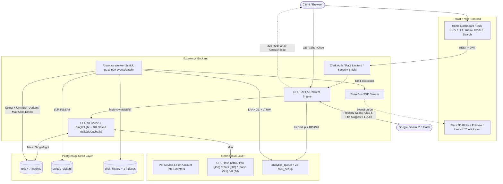

<div align="center">

  #  Lynq — Scaled URL Shortener & 3D Link Intelligence

  **Live Demo: [lynq.nisargvekariya.me](https://lynq.nisargvekariya.me)**

  [](https://vitejs.dev/)
  [](https://reactjs.org/)
  [](https://nodejs.org/)
  [](https://postgresql.org/)
  [](https://redis.io/)
  [](https://clerk.com/)
  [](https://ai.google.dev/)
  [](https://threejs.org/)

</div>

<br />

> **Full-stack URL shortener and real-time analytics platform built with React 18, Express, multi-tier L1 + Redis caching, Neon PostgreSQL, Clerk auth, Three.js WebGL globes, and Google Gemini AI.** Engineered for instant guest onboarding and full cloud portfolio management—free with zero paywalls.
>
> **Verified Live Load-Test Conclusion ([Full Load-Test Report](LOAD_TESTING.md)):** Passed **`11 / 11` production Grafana k6 suites (`196,606` live HTTP requests)** against `lynq.nisargvekariya.me` with **zero server crashes**:
> - **Peak Throughput:** Up to **`189.6` req/s (`~11,376` req/min)** in full-stack traffic (`120` VUs, **`0.00%` backend API errors**), **`146.5` redirects/s**, **`60.5` analytics reads/s**, and **`48.7` DB writes/s**.
> - **Concurrent Active Users:** Runs optimally at **`15–50` concurrent tight-loop VUs (`~54–110` req/s, `107–168ms` avg latency)** and scales cleanly up to **`300` concurrent active VUs** under instant viral spikes (`0.00%` dropped requests) and 70/30 read-write stress (`134.2` req/s, `99.96%` checks passed). *(Because k6 VUs loop every `50–500ms` with minimal pause, `50–300` concurrent VUs corresponds to substantially higher everyday human browsing concurrency.)*

---

## System Architecture

Lynq decouples hot-path link resolution from heavy analytics writes by layering an in-process LRU memory cache (`L1`) in front of Redis Cloud (`L2`), asynchronous Redis list queuing (`analytics_queue`), and batched PostgreSQL writes (`analyticsWorker.js`):



### Database & Caching Engineering

Every layer on the read, write, search, and analytics paths is optimized to minimize database round-trips and tail latency:

- **L1 Bounded $O(1)$ LRU Cache (`backend/utils/dbCache.js`)**: Separate in-memory TTL caches (`urlL1Cache` 2,500 entries / 15s TTL, `infoL1Cache` 600 entries / 10s L1 & 45s Redis, `statsL1Cache` 32 entries / 15s L1 & 30s Redis) serve repeated lookups in sub-millisecond RAM without TCP hops (`max_clicks`-limited links bypass `urlL1Cache` so caps stay accurate).
- **Singleflight Request Coalescing (`singleflight`)**: Collapses concurrent cache-miss requests for the same key into a single Redis/PostgreSQL flight to prevent cache stampedes.
- **Negative 404 Shield (`url_missing:<shortCode>`)**: Caches unknown short codes for 15 seconds in both L1 RAM and Redis so typo/scanner floods do not hit PostgreSQL.
- **Single-Pass `MATERIALIZED` CTE Analytics (`getUrlInfo`)**: Collapses 11 sequential fan-out analytics queries (summary, unique visitors, time-series buckets, devices, countries, cities, browsers, OS, referrers, regions/states, and geo-points) into **1 PostgreSQL query** per uncached `/api/info/:shortCode` request.
- **Set-Based PostgreSQL `UNNEST` Batching**:
  - `bulkShortenUrls`: Validates up to 100 CSV rows (requiring `url` + `title`, optional `alias`, 30-day default expiry), performs parallel duplicate/collision checks, executes a single `UNNEST` multi-row `INSERT`, and warms L1 + Redis via `multi()` pipelines.
  - `handleClaimLinks`: Transfers guest `editToken` and `device_id` links to an authenticated user account and clears `device_id` in one atomic `UNNEST` statement.
  - `analyticsWorker.js`: Drains up to 500 queued click events every 5 seconds with 2-second duplicate suppression (`click_dedup` + in-batch check), filters stale codes, batch-inserts `click_history` and `unique_visitors`, increments `clicks` & `last_visited` via single `UNNEST` `UPDATE`, deletes `max_clicks`-exhausted links, invalidates stale caches, emits SSE events, and re-queues DB failures up to 3 retries (`lPush`).
- **Optimistic `INSERT` Collision Retry**: Standard link shortening inserts directly and retries up to 5 attempts on PostgreSQL `23505` unique-constraint conflicts with escalating `nanoid` lengths (`alphabet` omits ambiguous `0/O/1/l/I`).
- **Targeted Indexes & Serverless Resilience (`backend/config/db.js`)**: **9 custom indexes** (`7` on `urls`, `2` on `click_history`) covering active user links, duplicate checks, guest device quotas, country counts, expiry checks, and sorted click timelines, backed by a `pg.Pool` (`max: 20`, `10s` idle timeout, `20s` connect timeout) with transparent transient-connection retry for Neon compute wakes.

---

## Key Features

### Analytics, Telemetry & Visualization
- **Interactive 3D Spherical Globe (`/stats/:shortCode`)**: WebGL country hex-polygon globe built with `react-globe.gl` and `three` using Natural Earth `110m` GeoJSON + an invisible full-country boundary hit-layer (`polygonsData`), featuring FlagCDN hover tooltips, `Peak / High / Medium / Low` visit-density tiers, quick-focus country chips, auto-orientation to the top country, Dark/Light globe themes, and a Top **States & Regions** sidebar powered by offline `geoip-lite` resolution (with clean fallback for local/private IPs).
- **Live Server-Sent Events (SSE) Click Pulse**: Streams incoming clicks live via `EventSource` (`GET /api/live/:shortCode`) to both the Home inline analytics card (`Analytics.jsx`) and `/stats/:shortCode` (`Stats.jsx`), displaying real-time click banners, optimistic live counters ahead of the 5-second worker flush, and `10s` heartbeats.
- **Deep Telemetry Breakdowns**: Tracks total vs. unique clicks (`visitor_hash`), hourly/daily trends (hourly during the first 48h, daily thereafter via Recharts), countries, regions/states, cities, device types (Recharts donut), browsers, OS (`ua-parser-js`), and acquisition referrers—rendering Globe, Timeline, Countries, States/Regions, Devices, and Referrers visually on `/stats/:shortCode` while surfacing `city`, `browser`, and `os` via live SSE banners, `GET /api/info/:shortCode`, and CSV exports (including preserved referrers across `/unlock/:shortCode` and `RedirectHandler.jsx` flows).
- **1-Click CSV Export**: Downloads full historical `click_history` records via `GET /api/analytics/:shortCode/export` (`Timestamp, Country, City, Device, Browser, OS, Referrer`).

### Security, Phishing Shield & Controls
- **Multi-Layer URL & Phishing Shield (`securityService.js` & `validator.js`)**:
  - Blocks private/loopback SSRF targets (`localhost`, `127.0.0.1`, `::1`, `10.x`, `172.16–31.x`, `192.168.x`) unless `TESTING_MODE=true`.
  - Blocks blacklisted domains, shortener chaining (`bit.ly`, `tinyurl.com`, `goo.gl`, `t.co`, `is.gd`, `buff.ly`, `ow.ly`), `19` high-risk TLDs (`.zip`, `.mov`, `.top`, `.tk`, `.click`, etc.), `13` typosquatting regexes + brand-credential spoofing (`paypal-verify`, `apple-login`, etc.), and spam keywords.
  - Triggers a **Google Gemini 2.5 Flash** credential-phishing scan (`2.5s` timeout guard, `>= 0.7` confidence threshold, fail-open on timeout/error) when URLs or titles include credential-sensitive terms (`login`, `signin`, `verify-account`, `wallet-connect`, etc.).
- **Password Protection (`/unlock/:shortCode`)**: Optional Bcrypt-hashed (`cost 10`) passwords for signed-in links (or in testing mode) with a dedicated unlock page and suppressed search/`Cmd+K` palette on unlock routes.
- **Auto-Destruct & Expirations**: Configure links to expire after `1–7` days for guests or `1–365` days for signed-in users (up to `36,500` days in testing mode), or auto-delete upon reaching a `maxClicks` unique-visitor threshold.
- **Destination Health Monitor (`statusService.js`)**: Checks target URL liveness (`HEAD` request with `6s` timeout, Redis-cached for `5` minutes) and surfaces live health badges/warnings in **`ResultCard.jsx`**, **`RecentUrls.jsx`** (bounded batches of 12), **`Preview.jsx`**, and **`Stats.jsx`**.
- **HTTP Hardening (`server.js`)**: `helmet` (`crossOriginResourcePolicy: cross-origin`), HTTPS redirect (`enforceHttps`, skipped in `TESTING_MODE`), CORS allowlisting, gzip compression, JSON body guard (`100kb`, raised to `5mb` in `TESTING_MODE`), and proxy trust (`trust proxy`).

### AI Productivity & Custom QR Studio
- **AI Auto-Fill (`POST /api/ai/suggest`)**: Extracts page titles/descriptions (`3s` fetch timeout with YouTube oEmbed + HTML metadata fallback) and prompts Gemini 2.5 Flash (`4s` timeout) to suggest a title, SEO custom alias, and comma-separated tags for signed-in users.
- **AI Alias Alternatives (`POST /api/ai/suggest-aliases`)**: Generates Gemini/heuristic (`-go`, `-hub`, `-hq`, etc.) slug alternatives verified live against PostgreSQL records when an alias is taken.
- **AI 2-Sentence Preview Summaries (`GET /api/ai/summary/:shortCode`)**: Summarizes destinations on `/preview/:shortCode` and `/stats/:shortCode`, cached in Redis for `7` days with deterministic local sentence synthesis fallback.
- **Custom QR Code Studio (`QRCodeCard.jsx` + `CustomQRCode.jsx` + `ColorPicker.jsx`)**: Custom SVG QR engine built on `qrcode` using **Error Correction Level `H`** (carving out a `~28%` center safe zone for uploaded logos), paired with a 2D HSV **+ Alpha Opacity** color & transparent-background picker with `EyeDropper`, `Square` vs `Round` module dots, and crisp **1024×1024 PNG** export.

### Accounts, Sync, Search & Platform UX
- **Seamless Guest Mode + Auto Cloud Sync**: Start shortening immediately without logging in (title + 1–7d expiry required; `10`-link local `lynq-recent` storage cap). Signing in via **Clerk** automatically claims guest `editToken` and `device_id` links via `POST /api/user/claim-links`, clears non-login local tracking, unlocks unlimited cloud storage + embedded **User Setting** (`UserProfile` + Profile Sign-Out), and switches limits per account.
- **Hybrid N-Gram Indexed Search (`frontend/src/utils/urlSearch.js`)**: Builds an in-memory 1-char / 2-gram / 3-gram sorted inverted index with an $O(1)$ exact-alias lookup table, skewed binary-search / two-pointer intersections, relevance scoring, and a 64-entry LRU query cache. Powers `RecentUrls.jsx` (latest 6 links + `Show all` expansion + inline URL editing) and the global `Cmd+K` / `Ctrl+K` **Command Palette** (`CommandPalette.jsx`).
- **Bulk CSV Engine (`BulkUpload.jsx`)**: Drag-and-drop CSV upload (requiring `url`/`link` & `title`, optional `alias`, 30-day default expiry) for up to **100 links** per batch (`5,000` UI limit under `VITE_TESTING_MODE`, unlimited API rows under `TESTING_MODE`; `5` batches/hour) processed in a single PostgreSQL `UNNEST` transaction with preview table and downloadable sample CSV.
- **Smart Dynamic Routing (API) & Deduplication**: `POST /api/shorten` and `PUT /api/shorten/:shortCode` support optional `routingRules` JSON (`device.ios`, `device.android`, `device.desktop`, expiration/max-click `fallbackUrl`, and weighted A/B `splitTest` variants), while standard non-password links deduplicate active URLs cleanly.
- **Unified Portal Tooltips, Live Health Widget & Public Showcase**: `TooltipLayer.jsx` renders theme-matched Dark/Light tooltips across `[data-tooltip]` controls (including disabled buttons and `:focus-visible` navigation); `ConnectionStatus.jsx` polls `/api/health` every 30s to display PostgreSQL & Redis status; and `LandingSections.jsx` showcases live `/api/platform-stats` counters and an interactive analytics demo.
- **Testing Mode (`TESTING_MODE` & `VITE_TESTING_MODE`)**: Single-flag switch bypassing Redis rate limits, guest caps, SSRF internal-IP checks, HTTPS enforcement, and bulk caps while enabling simulated `?testUser=<id>` (`x-test-user-id`) sessions without Clerk OTP/CAPTCHA.

---

## Tiered Quotas & Rate Limits

All limits are enforced via Redis-backed `express-rate-limit` counters keyed by **device hash** (`device:<md5(ip + ua)>`) for guests and **Clerk user ID** (`user:<userId>`) for signed-in accounts:

| Capability | Guest Mode (Per Device) | Signed-In Account (Per Login) |
| :--- | :--- | :--- |
| **Shorten Burst Limit** | `3` / minute | `20` / minute |
| **Shorten Hourly Limit** | `5` / hour | `100` / hour |
| **Shorten Daily Limit** | `10` / day | `500` / day |
| **General API Limit** *(excludes `/api/health` & SSE)* | `40` requests / min | `120` requests / min |
| **Max Active Stored Links** | `10` per device | Unlimited |
| **Max Link Expiry** | `7` days | `365` days |
| **AI Summaries (`/preview` & `/stats`)** | `20` / hour | `120` / hour |
| **Custom Aliases, Passwords, Tags, Max Clicks, Smart Routing (API)** | Locked (Sign in required) | Included |
| **Bulk CSV Upload (100 rows)** | Locked | `5` batches / hour |
| **AI Auto-Fill & Alias Alternatives** | Locked | `30` requests / hour |
| **Global `Cmd+K` Command Palette** | Hidden | Included |

> Setting **`TESTING_MODE=true`** (backend) and **`VITE_TESTING_MODE=true`** (frontend) bypasses all rate limits, guest link/expiry quotas, and the 100-row bulk CSV cap.

---

## REST API Reference

Base prefix: `/api` (plus root `/` and `/:shortCode` redirect). Routes marked **Auth** require a valid Clerk JWT via `requireAuth`; routes marked **Optional Auth** apply `user:<id>` when signed in or `device:<hash>` for guests.

### Health & Platform

| Method | Endpoint | Auth | Description |
| :--- | :--- | :--- | :--- |
| `GET` | `/` | Public | Basic API active status payload. |
| `GET` | `/api/health` | Public | Live PostgreSQL (`SELECT 1`), Redis (`PING`), and `testingMode` status. |
| `GET` | `/api/platform-stats` | Public | Cached platform counters (`totalLinks`, `totalRedirects`, `countriesCount`) + live Redis ping latency. |
| `GET` | `/api/limits` | Optional Auth | Tier limits, current Redis usage, remaining quota counts, and feature flags for caller (`device` or `user`). |

### Core Links, Redirects & Telemetry

| Method | Endpoint | Auth | Description |
| :--- | :--- | :--- | :--- |
| `POST` | `/api/shorten` | Optional Auth | Create a short URL (rate-limited `min`/`hr`/`day`; guests restricted to `1–7d` expiry & standard URLs). |
| `POST` | `/api/bulk-shorten` | Auth | Bulk-shorten up to 100 CSV link objects (`url` + required `title`, optional `alias`, 30d expiry) via `UNNEST` (`5` batches/hr). |
| `PUT` | `/api/shorten/:shortCode` | Optional Auth | Edit destination URL and optional `routingRules` (owner via Clerk `userId` or `editToken`). |
| `DELETE` | `/api/shorten/:shortCode` | Optional Auth | Delete a short link and purge L1 + Redis caches (owner via Clerk `userId` or `editToken`). |
| `GET` | `/api/info/:shortCode` | Public | Single-pass CTE analytics & metadata (cached in L1 RAM 10s + Redis 45s). |
| `GET` | `/api/analytics/:shortCode/export` | Public | Download historical `click_history` rows as CSV (`Timestamp, Country, City, Device, Browser, OS, Referrer`). |
| `GET` | `/api/live/:shortCode` | Public | Server-Sent Events (`text/event-stream`) live click pulse stream with 10s heartbeats (exempt from `apiLimiter`). |
| `GET` | `/api/check-alias/:alias` | Public | Check custom alias availability via L1 + Redis + PostgreSQL. |
| `GET` | `/api/status/:shortCode` | Public | Live HTTP `HEAD` liveness & response-time check for the target URL (6s timeout, 5-minute Redis cache). |
| `POST` | `/api/verify/:shortCode` | Public | Verify Bcrypt password for protected links, record click/GeoIP telemetry (with preserved referrer), and emit SSE. |
| `GET` | `/api/resolve/:shortCode` | Public | JSON resolve + async click queueing fallback for SPA routes. |
| `GET` | `/:shortCode` | Public | Core HTTP `302` redirect (or `302` to `${FRONTEND_URL}/unlock/:shortCode` if password-protected). |

### AI Endpoints

| Method | Endpoint | Auth | Description |
| :--- | :--- | :--- | :--- |
| `POST` | `/api/ai/suggest` | Auth | Generate SEO title, tags, and custom alias via Gemini 2.5 Flash + YouTube oEmbed/HTML scraper (`30`/hr). |
| `POST` | `/api/ai/suggest-aliases` | Auth | Generate available custom alias alternatives verified against PostgreSQL (`30`/hr). |
| `GET` | `/api/ai/summary/:shortCode` | Optional Auth | Generate/fetch 2-sentence destination TL;DR summary cached 7 days in Redis (`20`/hr guest, `120`/hr user). |

### User Portfolio & Sync

| Method | Endpoint | Auth | Description |
| :--- | :--- | :--- | :--- |
| `POST` | `/api/user/claim-links` | Auth | Atomically claim guest `editToken` links + `deviceId` links via `UNNEST` and clear guest `device_id`. |
| `GET` | `/api/user/links` | Auth | Fetch all short links belonging to the authenticated user. |
| `GET` | `/api/user/analytics/summary` | Auth | Aggregate account-wide clicks, active/total link counts, and top 3 links. |

---

## Frontend Routes

| Route | Component | Purpose |
| :--- | :--- | :--- |
| `/` | `Home.jsx` | Guest landing hero + shortener, or signed-in dashboard (`Your links`, `BulkUpload`, `User Setting` Clerk profile; supports `/?code=` & `/?tab=` deep links). |
| `/stats/:shortCode` | `Stats.jsx` | Full analytics suite with 3D WebGL globe, States/Regions sidebar, country/device/referrer breakdowns, live SSE feed, AI TL;DR, destination health, and CSV export. |
| `/preview/:shortCode` | `Preview.jsx` | Safe link inspection before visiting, displaying destination health (`HEAD` latency) and Gemini 2-sentence summary. |
| `/unlock/:shortCode` | `Unlock.jsx` | Password prompt screen for protected links (preserves referrer on unlock; hides search bar & Command Palette). |
| `/:shortCode` | `RedirectHandler.jsx` | Client-side SPA redirect fallback resolving short codes via `/api/resolve/:shortCode` (preserves referrer on redirect to `/unlock/:code`). |
| `/404` / `*` | `NotFound.jsx` | Custom expired / not-found error page. |

---

## Project Structure

```text
Lynq/
├── backend/                     # Node.js + Express ESM API
│   ├── config/                  # db.js (PostgreSQL + 9 indexes), redis.js, env.js, eventBus.js
│   ├── controllers/             # aiController, bulkController, statusController, urlController, userController
│   ├── middlewares/             # auth.js (Clerk), rateLimiter.js (Tiered Redis), security.js, errorHandler.js
│   ├── routes/                  # aiRoutes.js, urlRoutes.js, userRoutes.js
│   ├── services/                # urlService, bulkService, aiService, securityService, statusService
│   ├── utils/                   # dbCache.js (L1 LRU + Singleflight + Negative Shield), telemetry.js, validator.js, codeGenerator.js
│   ├── workers/                 # analyticsWorker.js (5s queue consumer + UNNEST batches + SSE emit)
│   ├── server.js                # Express app bootstrap & route registration
│   ├── test-gemini.js           # Standalone Gemini model check helper
│   ├── nodemon.json             # Dev watcher config
│   ├── .env.example             # Backend environment template
│   └── package.json
├── frontend/                    # React 18 + Vite 8 Web Application
│   ├── public/                  # logo.png, favicon.svg, GeoJSON globe dataset, globe-hexed-polygons.html prototype
│   ├── src/
│   │   ├── components/          # UrlInput, BulkUpload, RecentUrls, ResultCard, Analytics, QRCodeCard, CustomQRCode,
│   │   │                        # ColorPicker, GlobeView, CountryFlag, CommandPalette, LandingSections,
│   │   │                        # ConnectionStatus, ThemeToggle, Toast, TooltipLayer, AppHeader, AppFooter (+ UserPortfolio)
│   │   ├── context/             # AuthContext.jsx (Clerk session sync, test user auth & auto guest link claiming)
│   │   ├── hooks/               # useLocalStorage.js, useTheme.js, useToast.js
│   │   ├── pages/               # Home, Stats, Preview, Unlock, RedirectHandler, NotFound
│   │   ├── services/            # api.js (Axios + Clerk JWT + device ID header)
│   │   ├── utils/               # urlSearch.js (Inverted n-gram search), geoCoordinates.js, telemetry.js, csv.js
│   │   ├── App.jsx              # Router, TooltipLayer, ConnectionStatus & global Cmd+K CommandPalette
│   │   ├── index.css            # Global CSS variables & Light/Dark theme tokens
│   │   └── main.jsx             # Root entry + ClerkProvider theme configuration
│   ├── index.html               # HTML shell & Google Fonts (Inter)
│   ├── vite.config.js           # Vite dev proxy (/api -> 127.0.0.1:5000)
│   ├── vercel.json              # Vercel SPA rewrite configuration
│   ├── .env.example             # Frontend environment template
│   └── package.json
├── load-tests/                  # Local Grafana k6 load & browser test suite (gitignored)
├── LOAD_TESTING.md              # Full 11-suite production benchmark analysis
├── .gitignore
└── README.md
```

---

## Getting Started (Local Development)

### Prerequisites

- **Node.js** `v18+` (recommended `v20+`)
- **PostgreSQL** connection URL (e.g., Neon serverless or local Postgres with SSL enabled)
- **Redis** instance (e.g., Redis Cloud or local Redis server)
- **Clerk** account (`CLERK_PUBLISHABLE_KEY`, `CLERK_SECRET_KEY`, `VITE_CLERK_PUBLISHABLE_KEY`) for authentication & user dashboard features *(optional: omit Clerk keys to run in guest/single-mode fallback)*
- **Google Gemini API Key** (`GEMINI_API_KEY`) for AI auto-fill, alias suggestions, summaries, and AI phishing checks *(optional: degrades gracefully without it)*

### 1. Clone & Install

```bash
git clone https://github.com/zevrik/Lynq.git
cd Lynq

# Install Backend dependencies
cd backend
npm install

# Install Frontend dependencies
cd ../frontend
npm install
```

### 2. Configure Environment Variables

Create `backend/.env` (and optionally `frontend/.env`) from the templates:

```bash
cp backend/.env.example backend/.env
cp frontend/.env.example frontend/.env
```

#### Backend Variables (`backend/.env`)

| Variable | Required | Default / Example | Description |
| :--- | :--- | :--- | :--- |
| `PORT` | No | `5000` | Express server port. |
| `NODE_ENV` | No | `development` | `development` or `production` (enables HTTPS redirect behind proxy when `TESTING_MODE=false`). |
| `BASE_URL` | No | `http://localhost:5000` | Public backend origin for CORS allowlist. |
| `FRONTEND_URL` | Yes | `http://localhost:5173` | Frontend origin used in generated short URLs, unlock redirects & CORS. |
| `DATABASE_URL` | Yes | `postgresql://...` | PostgreSQL connection string (`ssl: { rejectUnauthorized: false }` in `db.js`). |
| `REDIS_HOST` | Yes | `localhost` | Redis host address. |
| `REDIS_PORT` | Yes | `6379` | Redis port number. |
| `REDIS_USERNAME` | No | `default` | Redis ACL username. |
| `REDIS_PASSWORD` | No | `""` | Redis password (required for authenticated Redis Cloud). |
| `SHORT_CODE_LENGTH` | No | `6` | Default generated short code length (`nanoid`). |
| `CLERK_PUBLISHABLE_KEY` | Optional | `pk_test_...` | Clerk publishable key for JWT verification middleware. |
| `CLERK_SECRET_KEY` | Optional | `sk_test_...` | Clerk secret key enabling authenticated endpoints & quotas. |
| `GEMINI_API_KEY` | Optional | `AIza...` | Google Gemini API key (`gemini-2.5-flash`). |
| `TESTING_MODE` | Optional | `false` | Set `true` during testing to bypass rate limits, guest caps, bulk 100-row cap, SSRF `localhost`/internal-IP blocks, HTTPS enforcement, raise JSON limit (`100kb` → `5mb`), and enable `x-test-user-id` auth (legacy `LOAD_TEST_MODE=true` also accepted). |

#### Frontend Variables (`frontend/.env`, optional in local dev)

| Variable | Required | Default / Behavior | Description |
| :--- | :--- | :--- | :--- |
| `VITE_CLERK_PUBLISHABLE_KEY` | Optional | Enables Clerk Sign-In & Profile UI | If omitted, frontend runs in instant guest shortener mode. |
| `VITE_API_URL` | No | `/api` | Proxied to `http://127.0.0.1:5000` in Vite dev; set to your deployed backend `/api` URL in split deployments (e.g., Vercel). |
| `VITE_TESTING_MODE` | Optional | `false` | Set `true` during testing to unlock unlimited UI expiry, advanced guest options, 5,000-row bulk CSV, `30s` Axios timeout, and simulated `?testUser=<id>` auth without Clerk OTP/CAPTCHA. |
| `VITE_TEST_USER_ID` | Optional | `""` | Default simulated user ID (`x-test-user-id`) applied automatically when `VITE_TESTING_MODE=true` (override or clear dynamically with `?testUser=<id\|off>`). |

### 3. Start Backend & Frontend

**Terminal 1 — Backend:**

```bash
cd backend
npm run dev
```

**Terminal 2 — Frontend:**

```bash
cd frontend
npm run dev
```

Open **`http://localhost:5173`** in your browser!

---

## Load Testing

Lynq is benchmarked end-to-end with **Grafana k6 (`v2.1.0`)** (`HTTP/2` protocol engine + `k6/browser` Chromium Web Vitals) across both the deployed **Vercel SPA (`https://lynq.nisargvekariya.me`)** and **Cloudflare → Render API (`https://api.lynq.nisargvekariya.me`)**.

- **11 / 11 Live Suites Passed (`196,606` Requests):** Sustained up to **`189.6` req/s (`~11,376` req/min)** with **`0.00%` backend API errors** at `120` concurrent VUs, **`146.5` redirects/s**, **`60.5` cached analytics reads/s** (`107.6ms` avg), **`48.7` DB writes/s**, and **zero server crashes up to `300` concurrent active VUs** (`live:spike` & `live:stress`).
- **Quick Start (local gitignored `load-tests/` suite):**

```bash
cd load-tests
npm install
npm run live:smoke       # 1 VU E2E verification + cleanup
npm run live:fullstack   # 15 -> 50 VU split Vercel + Render load
npm run live:browser     # Headless Chromium Core Web Vitals (LCP/FCP/TTFB)
```

> 📖 **Deep-Dive Analysis:** Read **[LOAD_TESTING.md](LOAD_TESTING.md)** for the full `11`-suite benchmark scorecard, Chromium Core Web Vitals, split-origin test methodology, and bottleneck/cache analysis (or `load-tests/README.md` for local runner flags and `.env.prod` tuning). Remember to restore **`TESTING_MODE=false`** (and **`VITE_TESTING_MODE=false`** on frontend) after running live benchmarks.
